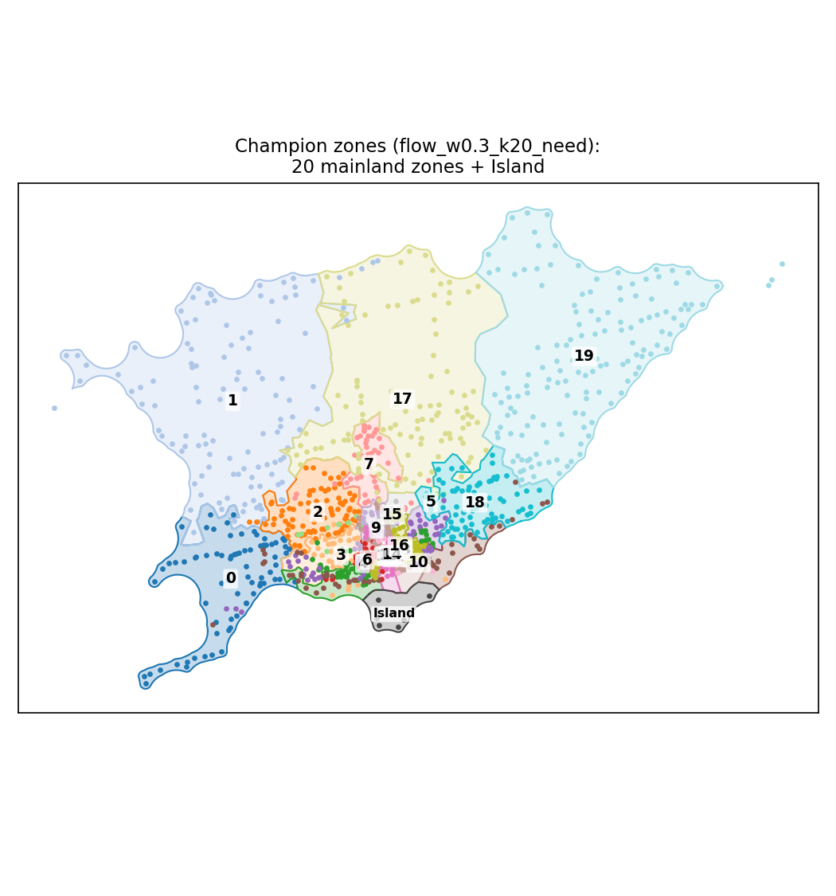
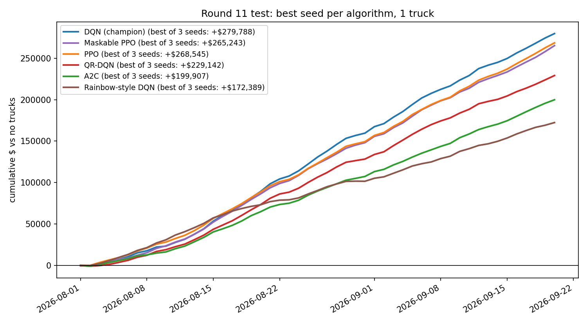

# Toronto Bike Share Rebalancing with Reinforcement Learning

**Chi Zhang · Brett Zeleznik · Tahera Yesmin**

**[▶ Live dashboard](https://zhangchi9.github.io/toronto_bike_share_rl/)**: replay every
station and truck minute by minute, Aug 1 – Sep 30, 2026, under five solutions (no
trucks, a fixed shuttle, the DQN, the DQN + lookahead planner, and two trucks on split
territories). Station colour shows how full each station is, every ride in progress is
an arrow from its start station to its destination, and running totals (reward, rides
served and lost, bikes moved) update as it plays. It runs entirely in the browser, with
no install.

## The problem

Toronto's bike share system runs ~1,070 docking stations. Commuting is
one-directional, so stations drift out of balance within hours: downtown
fills with returned bikes every morning and empties every evening (the
reverse at residential stations). That produces two costly failures — a
rider who finds an empty station loses the ride outright, and one who finds
a full station gets redirected and degrades the operator's return revenue.

The fix — trucks that move bikes between stations — is itself expensive: a
fixed daily cost and driver shift whether or not the truck is used, plus
fuel. So the real decision isn't "should we rebalance," it's: **at every
moment a truck is free, where should it drive and how many bikes should it
carry, to maximize profit — not just bikes moved?**

This project frames that as a reinforcement learning problem, trains an
agent to make that call, and tests it against simpler alternatives on a
single, continuous 51-day replay of real 2026 trip data (Aug 1–Sep 20) that
no model ever trains or validates on.

**Full write-up, with every round's results and all figures:**
[docs/report.md](docs/report.md)

## Results

| Policy | Trucks | Gain vs. no trucks | Fulfilled |
|---|---|---|---|
| No trucks | 0 | $0 (the floor) | 85.15% |
| Fixed shuttle (no learning, no inputs) | 1 | +$59,824 | 86.78% |
| Best single RL algorithm (DQN) | 1 | +$257,204 | ~90.2% |
| **DQN + lookahead planner (champion)** | **1** | **+$333,282** | **~90.5%** |
| Independent 2-truck territories | 2 | +$236,685 (worse than 1 truck) | 91.0% |
| Coordinated 2-truck DQN | 2 | +$72,040 (much worse) | varies |

Fulfilled % is the share of ride requests a bike was actually available for.
Both 2-truck fleet costs are roughly double a 1-truck fleet's, so neither
pays for its own extra truck yet — see "Open problems" below.

## How it's framed as RL

- **Zones, not stations.** The literal action space — "move N bikes from
  station X to station Y" — would be about 1,070² (over a million pairs),
  impossible to meaningfully explore. Stations are instead clustered into
  ~20 zones, built from a blend of road drive time and demand-pattern
  similarity (not hand-drawn), shrinking the action space to ~20² pairs.
  Zones are balanced not just on dock count but on each station's
  historical *rebalancing need* — this change alone removed a training
  collapse that occasionally sank an otherwise-fine agent.

  
- **One decision per idle truck.** The agent is asked only when a truck
  goes idle; it chooses to wait, or to send the truck on a multi-stop
  mission to a zone, picking up or dropping off up to 5 bikes per station
  in order of projected need, discounted by travel distance.
- **What the agent sees.** Per-zone fill/empty/full/trend, a short-horizon
  demand forecast (a gradient-boosted model trained only on data before the
  test period), time of day and day of week, every truck's position and
  load — plus four extra engineered feature groups (risk, travel, recent
  failures, memory) that only helped as a full combination, not separately.
- **Reward = $ gained over doing nothing.** Training reward each minute is
  the true dollar outcome minus what a no-truck run would have earned that
  same minute, with the one unavoidable cost (the daily truck hire) added
  back — so the signal isn't swamped by a cost no policy can ever avoid,
  and it's the same number reported as every headline result.

## What was tried

- **Six RL algorithms**, same inputs, same training budget: DQN, PPO, A2C,
  QR-DQN, Maskable PPO, and a Rainbow-style DQN. Plain DQN won and was also
  the most consistent across training seeds — the distributional and
  Rainbow-style variants, built for harder value-estimation problems, did
  measurably worse here.

  
- **A lookahead planner on top of the trained DQN** — the project's single
  biggest win, and it adds no new learned parameters. At each decision it
  takes the DQN's 8 best candidate moves, rolls each one forward 24
  simulated hours (using real past days as demand scenarios, never a peek
  at the actual future), and executes whichever candidate scores best on
  average. It overrides the DQN's own top pick on ~90% of decisions, and
  the override is worth +$76,079. The cost is compute: a full test run
  takes hours per seed instead of minutes.
- **A second truck, two ways** — a hard territory split (two independent
  DQNs, each seeing only its own half of the city) and a fully coordinated
  whole-city DQN (both trucks sharing one policy and seeing each other's
  orders). Both lost money net of the second truck's cost; the coordinated
  version, built specifically to fix the bugs diagnosed from the
  territory split's failure, did *worse*, not better. The likely cause:
  a joint 2-truck policy is a substantially harder learning problem than
  reusing a strong 1-truck policy, under the same training budget.

## Open problems

Two questions decide whether an operator could actually run this
(details in [the report's Discussion](docs/report.md#33-discussion-and-next-steps)):

- **More than one truck.** The champion's truck is busy 99% of the time, so
  there is work for a second one, but both 2-truck policies lost money net of
  its cost. The trucks share one stock of bikes, each is a moving target for
  the other while they learn, and the shared reward doesn't say which truck
  earned it. Next steps, cheapest first: let the lookahead planner coordinate
  the trucks (no new training), start 2-truck training from the champion's
  weights, give each truck its own credit (difference rewards or cooperative
  multi-agent methods), and hire the second truck only for peak hours.
- **A different season.** Training, validation and test are all May–September.
  January–February has about a tenth of August's trips, mostly members, on
  fewer stations, while a truck still costs $260 a day. January–April 2026 is
  already in the trip log and unused, so the next test runs every policy
  unchanged on a winter window (Jan–Feb) and a spring window (Mar–Apr), plus a
  planner variant whose scenarios come from recent weeks instead of summer.

## Repo layout

| Path | What's there |
|---|---|
| `bikeshare_env/` | The simulator: trip replay, stations, trucks, rewards |
| `rl/` | Zones, features, the demand forecast, training, the lookahead planner, evaluation |
| `models/` | Trained agents, by round |
| `results/` | Per-round test results, metrics and figures |
| `docs/report.md` | The full write-up (also exported as `docs/report.docx` and `docs/report_slides.pptx`) |
| `app.py` / `dashboard_data.py` | Interactive dashboard — replay any trained policy over any date range |
| `deploy/` | Builds the dashboard for the web: a static site for GitHub Pages (the live link above) or a Hugging Face Space ([deploy/README.md](deploy/README.md)) |
| `tests/` | The test suite |

## Running it

```bash
pip install -r requirements.txt
python app.py                                 # dashboard at http://localhost:8050
python -m deploy.build_static                 # the static web copy, in deploy/static_site/
python -m rl.train --algo dqn --trucks 1      # retrain the champion DQN
python -m rl.eval_round13                     # test the lookahead planner
pytest tests/                                 # run the test suite
```
