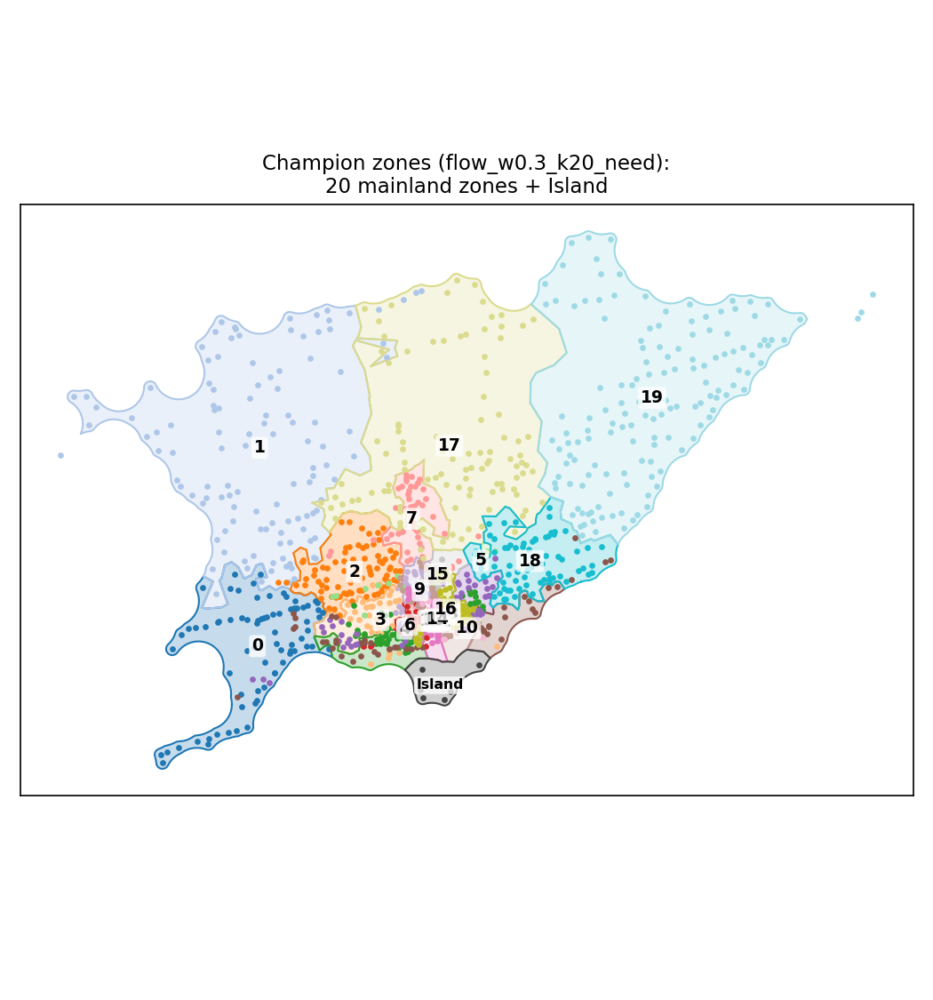
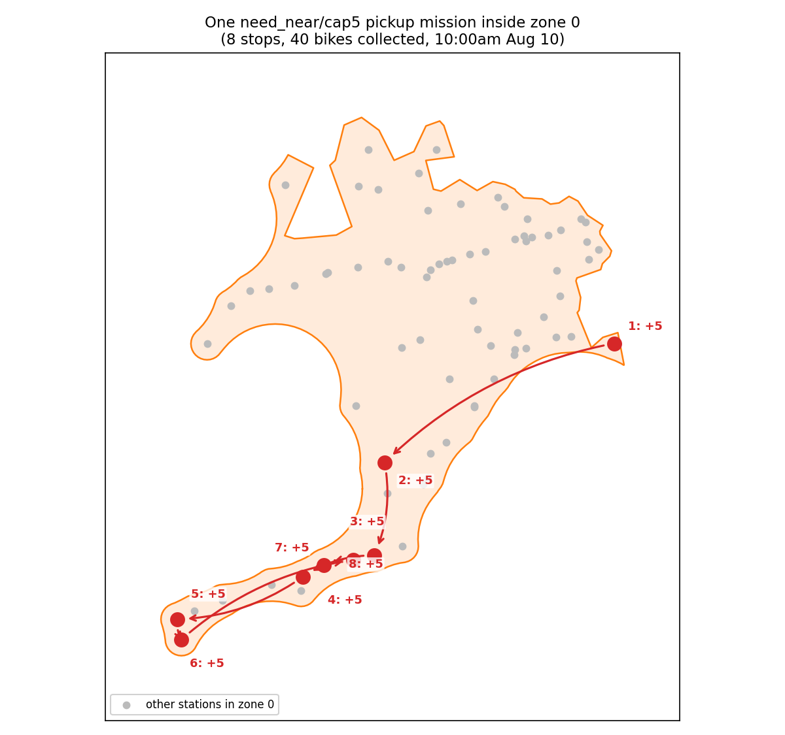
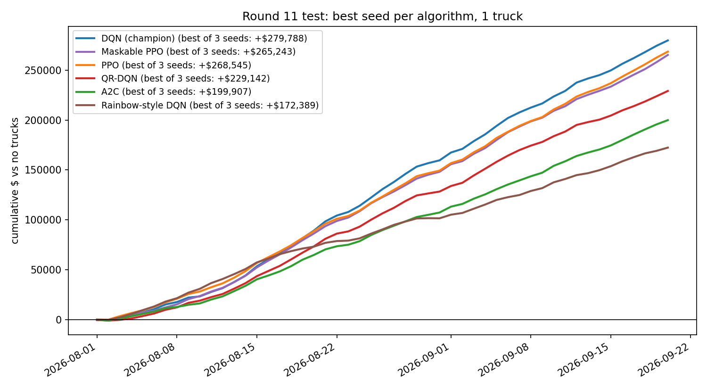

# Toronto Bike Share Rebalancing with Reinforcement Learning

## TL;DR

- **Problem:** Toronto's bike stations run empty or full because commuting is
  one-directional; that loses rides outright or degrades them, and the fix
  — rebalancing trucks — is itself expensive, so the real decision is
  *where a truck should drive and how many bikes it should carry, to
  maximize profit, not bikes moved.*
- **Framed as an MDP:** stations grouped into ~20 zones (built from road
  time + demand similarity, not hand-drawn); the agent decides zone-to-zone
  moves only when a truck is idle; reward is the true $ outcome minus what
  no truck would have earned the same minute, so the agent is scored on the
  same number used throughout the report.
- **Baselines:** no trucks ($0, the floor) and a fixed one-truck shuttle
  route with no learning (+$59,824) — a simple, non-adaptive rule that
  still beats doing nothing.
- **The learned solution:** a DQN, with zones tuned for consistency (not
  just average dock count) and four engineered feature groups (risk,
  travel, recent failures, memory), beat five other RL algorithms
  (PPO, A2C, QR-DQN, Maskable PPO, Rainbow-style DQN) — **+$257,204**.
- **Decision-time search on top, for free:** a lookahead planner that reuses
  the same trained DQN to generate and roll out candidate moves, with no
  extra training, added another **+$76,079** — **+$333,282** total, ~90.5%
  of rides fulfilled vs. 85.15% with no trucks. This is the project's
  current champion.
- **A second truck doesn't pay for itself — yet.** Both a hard territory
  split and a fully coordinated two-truck DQN earned *less* than one truck
  alone, net of the second truck's cost; fixing the specific coordination
  bugs diagnosed from the first failure made the second attempt worse, not
  better. This remains an open problem.

## 1. Business Problem

Toronto's bike share system (Bike Share Toronto) runs about 1,070 docking stations
across the city, each with a fixed number of docks. Riders unlock a bike at one
station and return it to any other station with a free dock. This only works if
bikes and empty docks are both available where and when riders need them — and
left alone, the system drifts out of balance within hours:

- **Commuting patterns are one-directional.** Downtown stations fill with
  returned bikes every morning and empty out every evening (and the reverse at
  residential stations), so docks run out on one side of the trip and bikes run
  out on the other.
- **Two failures, both costly.** A rider who finds an **empty station** can't
  start a trip and the ride is lost outright. A rider who finds a **full
  station** can't end theirs; the system redirects them to the nearest station
  with space, but that rider pays for extra ride time they didn't want and the
  operator loses the normal return-triggered revenue.
- **The imbalance compounds.** Every lost rental and every blocked return is
  also a bike that never moved, so the same stations stay empty or full and the
  next rider hits the same wall.

The fix the industry uses is **rebalancing**: trucks drive bikes from
stations that have too many to stations that have too few. But running trucks
is itself expensive — a truck costs money whether it's driving, waiting, or
parked, through a fixed daily cost, driver hours, and fuel — and a truck sent
to the wrong zone, at the wrong time, or carrying the wrong number of bikes
does nothing for the stations that actually needed it. The operator is really
choosing, continuously, where each truck should go, when, and with how many
bikes, under a budget that makes the wrong choice a net loss.

### What we are solving for

**Decide, at every moment a truck is free, where it should drive and how
many bikes it should carry — to maximize system-wide profit, not just bikes
moved.**

Profit here nets three things against each other every minute:

1. **Revenue kept**, from unlocks and ride time that would otherwise have been
   lost to an empty station or degraded by a blocked return.
2. **Revenue still lost**, from requests no truck reached in time.
3. **The cost of running trucks** — a fixed cost and driver shift whether or
   not they are used that day, plus fuel for every kilometer driven.

A policy that moves a lot of bikes but drives too far, or keeps a truck on
payroll it barely uses, can lose money even while "helping." A good policy
has to weigh the dollar value of each potential rebalancing trip against what
that trip costs, continuously, across an entire city of stations and through
days of shifting demand — which is exactly the kind of sequential,
high-dimensional decision problem reinforcement learning is suited to, and
which a fixed human-written rule struggles to adapt to as demand shifts by
hour, day of week, and season.

### Why not a simpler fix

- **More docks everywhere** removes the constraint but is a multi-year capital
  project, not an operating decision, and doesn't fix the one-directional flow
  that causes the imbalance in the first place.
- **A fixed shuttle route or hand-written threshold rule** (e.g., "truck
  visits the same 5 stations every morning," or "move bikes whenever a
  station is below 20% full") is cheap to build but can't weigh a move's cost
  against its payoff, can't adapt to a Tuesday vs. a rainy Saturday, and we
  show later in this report that it struggles to beat even a random
  dispatcher on the same budget.
- **More trucks** scales cost linearly and still depends on dispatching them
  well — it doesn't answer the underlying question of *where* and *when*.

This report evaluates whether a **learned dispatch policy** — an agent that
observes the state of the system and decides truck routes and loads — can
outperform these simpler alternatives by enough to justify the additional
engineering, and under what conditions it does or doesn't hold up.

## 2. Problem Setup: Casting Rebalancing as an RL Problem

Rebalancing is a sequential decision problem: every choice a truck makes
changes which stations are empty or full an hour from now, which changes what
the *right* next choice is. That loop — decide, observe the consequence,
decide again, with the consequence of today's decision landing partly in the
future — is exactly what a Markov Decision Process (MDP) formalizes, and what
reinforcement learning is built to optimize. This section describes the four
pieces of that MDP as implemented: the simulator the agent acts in, what it
observes, what it can decide, and what it's paid.

### 2.1 The simulator (the environment)

The environment (`BikeShareEnv`) replays Toronto's real 2026 trip log minute
by minute against a city of ~1,070 stations (1,065 reachable by road, plus 7
Toronto Island stations that are ferry-only and never visited by trucks). Each
simulated minute:

1. **Returns land.** A bike due back at its destination docks if there's a
   free slot; if not, it's held and "overflows" to the nearest station with
   room 15 minutes later — the rider still pays, but at a reduced per-minute
   rate, and the operator's return revenue drops.
2. **Rentals start.** If the requested station has a bike, the rider takes it
   (revenue); if not, the trip is lost outright (a flat penalty, and no
   revenue).
3. **Trucks that finished an action update the world** — bikes move from the
   stations they picked up at to the stations they dropped at.
4. **Costs accrue.** Every truck is **hired for the whole day** at midnight —
   a fixed cost plus a full driver shift — whether it's used that day or not,
   so an idle truck is a sunk cost, not a free option. Driving burns fuel per
   kilometer, and any truck time outside the 9am–5pm shift is paid overtime.

A full episode is **7 simulated days**, always starting at 35% of capacity
(matched to Bike Share Toronto's real midnight occupancy). Training samples
random 7-day windows from May 1–Jul 17, 2026; two fixed weeks (Jul 18–31) are
held out for picking the best checkpoint during training; and a single
**continuous 51-day run, Aug 1–Sep 20**, with bikes carrying over day to day,
is the untouched test every result in this report is measured on.

### 2.2 Why zones, not stations

The most literal action space — "send a truck to station X with N bikes" —
is enormous (over 1,000 stations) and mostly irrelevant: a truck doesn't need
to pick one exact station out of 50 that are all clustered together and all
running low. We instead **group stations into ~20 zones** and let the agent
reason at that level: *move bikes from zone A to zone B*. A zone-assignment
rule then expands that into an actual multi-stop route (Section 2.4).

The zones themselves are built, not hand-drawn, by clustering stations on a
blend of:
- **road drive time** between stations (so a zone is something a truck can
  actually loop through), and
- **similarity of demand pattern** (so a zone's stations tend to empty and
  fill together, rather than needing opposite treatment),

balanced so no zone is wildly bigger than another in the training signal that
matters (further tuned across rounds — see Section 4 — between balancing on
raw dock count and balancing on each station's historical *rebalancing need*,
i.e. how often it actually ran empty or blocked). The 7 Island stations form
their own zone, excluded from clustering and from truck actions, since trucks
can never reach them.

### 2.3 State: what the agent sees

At the moment a truck becomes idle, the agent receives a vector of continuous
features (not the raw ~1,070-station bike counts). Per zone, it sees:
fill ratio, share of its stations currently empty, share currently full, and
net change in bikes over the last hour — plus, per zone, a short-horizon
**demand forecast** (expected rentals and returns per dock in the next 60 and
180 minutes, from a model trained only on data before the test period). It
also sees the time of day (as sine/cosine, so midnight and 11:59pm are
numerically close), the day of week, where the asking truck is and how loaded
it is, and the same for every other truck in the fleet (location, busy
status, minutes left on its current mission) — so with more than one truck,
each agent decision is implicitly coordinated with what the other trucks are
already doing.

On top of that base observation, later rounds (Section 4) tested four
optional feature groups, each a small additional block per zone:
- **risk** — share of a zone's stations projected to be empty or full 1–2
  hours ahead (current bikes plus that station's typical net flow for the
  time of day), and how many bikes a truck could actually collect or drop
  there under the 5-bike-per-stop rule;
- **travel** — road minutes from the asking truck to each zone;
- **failures** — lost rentals and blocked returns the zone has produced in
  the last hour;
- **memory** — minutes since this truck last picked up from, or dropped at,
  each zone (so it doesn't thrash between the same two zones).

### 2.4 Action: what the agent decides

The agent is only asked for a decision **when a truck is idle** — a busy
truck's row is simply skipped, so the agent never wastes a decision on a
truck mid-mission, and several trucks going idle in the same minute are
asked one at a time before the minute advances. Each decision is one of:

- **wait** (do nothing this minute, ask again next minute), or
- **move `Q` bikes from zone A to zone B**, for every ordered pair of
  reachable zones and `Q ∈ {10, 20, 40}` (a 40-bike truck can be sent
  partially or fully loaded).

That's a single `Discrete` action space of size `1 + Z·(Z−1)·3` (≈1,141 for
20 zones) — small enough for standard value-based RL, unlike the raw
station-pair space.

A chosen move becomes a **multi-stop mission**: the truck drives into zone A,
visits its stations in order (by default, fullest-first), picking up **at
most 5 bikes per stop** until it's carrying the requested amount or has
visited every station, then drives to zone B and drops off the same way
(emptiest-dock-first), visiting further stations if one fills up before the
whole load is placed. The truck is "busy" — unavailable for a new decision —
for the whole mission, typically on the order of an hour. (Round 10 tested
replacing "fullest/emptiest-first, 5 at a time" with rules based on travel
distance or projected 2-hour need; the simple default held up best — see
Section 4.)

### 2.5 Reward: what the agent is paid for

The environment's **true** reward each minute is the operator's actual net
cash flow: unlock + ride revenue (full rate for a normal return, a reduced
rate for an overflowed one) minus lost-trip penalties minus that minute's
labor, fuel, and fixed truck costs. This is the number every result in this
report (e.g., "+$257,204 vs. no trucks") is ultimately measured in. Concretely,
every dollar in that number comes from one of these situations:

| Situation | What happens | $ effect | When it's counted |
|---|---|---|---|
| Rider unlocks a bike | A station has a bike when requested | **+$1.00** flat | Instantly, at the start of the ride |
| ...ride ends at a station with room | The bike docks normally | **+$0.15 × ride minutes** | At the moment of return |
| ...ride ends at a **full** station | No dock free; the bike is held and redirected to the nearest open station 15 min later | **+$0.10 × ride minutes** (reduced rate) | 15 minutes after the attempted return |
| Rider requests a bike, station is **empty** | Trip never happens | **−$0.50** penalty, **$0** revenue | Instantly, at the attempted start |
| Truck drives | Any distance covered, loaded or not | **−$0.30 / km** fuel | As the drive happens |
| Truck is busy outside its 9am–5pm shift | Loading, unloading, or driving at night | **−$40 / hour** (vs. $20/hour in-shift, already sunk) | Per busy minute outside the shift |
| Fleet hired for the day | Every truck, at midnight, whether it's used that day or not | **−$100 fixed − $160 shift** ($260/truck/day) | Once per truck, every midnight |

The first four rows are driven entirely by riders and where the bikes happen
to be; the agent influences them only indirectly, by having moved bikes
earlier. The last three rows are the only ones a policy spends directly —
and the last one it can't avoid at all, which motivates the reward shaping
below.

The reward the agent **trains on** is a reshaped version of that true
reward, for one reason: the daily fixed-and-shift cost is paid at midnight
*no matter what the agent does* — even the best possible policy can't avoid
hiring the trucks it was given — so if left untouched, that fixed charge
would swamp a decision with a signal the agent has no way to act on. Each
minute's training reward is therefore:

> (true $ reward that minute − the $ a *zero-truck* run earns in that same
> minute of that same week, with the unavoidable daily fleet cost added back)
> ÷ 10

Subtracting the no-truck baseline turns the reward into "how much better or
worse than doing nothing," which (a) centers the signal near zero so the
network isn't chasing a huge, mostly-fixed number, and (b) is the same
quantity used throughout this report as the headline metric, so training
reward and reported performance are aligned. Dividing by 10 is pure scaling,
for numerical stability.

Because a truck mission can take an hour, most of a decision's payoff — extra
rentals from bikes it placed, extra successful returns from docks it freed —
lands in the rewards of *later* decisions, not the one that caused it. The
agent has to learn that connection itself; Section 3 covers how.

## 3. Solution

All dollar figures below are the test-period gain over the no-truck baseline
(Aug 1–Sep 20, 51 days, 3 training seeds unless noted), the same measure
introduced in Section 2.

### 3.1 Baselines

Before any learning, two reference policies set the floor and a simple
human-written ceiling.

**No trucks.** The dummy policy: no truck is ever hired, so it pays no truck
cost at all, and every empty-station or full-station event simply happens.
This is the $0 line everything else is measured against — $6,057,953 in true
revenue over the test period, 85.15% of ride requests fulfilled.

**Fixed shuttle (1 truck).** The simplest possible rebalancing rule: one
truck, running every day, always shuttling 10 bikes from the busiest
downtown zone to the residential zone just north of it, on a fixed single
pickup/single drop-off route, with no inputs and no learning at all — it
doesn't even look at how full either zone currently is. It represents "hire
one truck and give it the one obviously-right route a planner would guess by
eye."

| Policy | Trucks | Gain vs no trucks | Fulfilled | Lost requests | Blocked returns |
|---|---|---|---|---|---|
| No trucks | 0 | $0 | 85.15% | 302,201 | 105,163 |
| Fixed shuttle | 1 | +$59,824 (≈$8,200/week) | 86.78% | 269,166 | 89,195 |

The one-truck shuttle earns back its own cost and then some — the obvious
move genuinely helps. But it doesn't adapt: it runs the same route at 3am as
at rush hour, with no regard for which zones actually need it right now.

### 3.2 Reinforcement Learning Approach

#### 3.2.1 Clustering stations into zones

A truck decision shouldn't have to name one exact station out of ~1,070 —
nearby stations usually need the same treatment at the same time, and
letting the agent choose among them directly makes the action space
enormous for no real benefit. If every decision were "pick up at station X,
drop off at station Y," the action space would be about 1,070² — over a
million station pairs, before even choosing how many bikes to carry. No
amount of training data lets an agent meaningfully explore a space that
size; almost every pair would be tried a handful of times at best, and the
agent would never learn which ones actually matter. Stations are instead
**clustered into 20 mainland zones** (plus a 21st zone for the 7 ferry-only
Island stations, which trucks never visit), shrinking the decision to
roughly 20² = 400 zone pairs — small enough to actually learn over — and the
agent reasons about zone-to-zone moves; a zone's actual stations are only
decided when a move is carried out (Section 3.2.2).

Zones are built, not hand-drawn, from a station-to-station distance that
blends two things:

- **road drive time** (so a zone is something a truck can actually loop
  through, not an arbitrary shape), and
- **similarity of hourly demand pattern** (so a zone's stations tend to
  empty or fill *together*, which is what makes "move bikes from zone A to
  zone B" a meaningful instruction at all),

mixed 30% road time / 70% demand similarity — a weight tested at 0.3, 0.5
and 0.7 early on; 0.3 gave the best downstream agent performance and is used
throughout. Zones are then assigned by solving a balanced-assignment problem
(so every zone ends up a similar "size") and refined so no station sits
oddly far from its own zone's other stations.

The harder question turned out to be *what "similar size" should mean.*
Balancing purely on dock count gave zones that looked even on a map but
trained **unreliably**: of three otherwise-identical DQN training seeds on
those zones, one collapsed to almost no gain at all (+$17,442, against
+$199,000 and +$286,000 for the other two) — a single unlucky zone layout
could sink an entire training run. Rebalancing instead on a 50/50 mix of
dock count and each station's **historical rebalancing need** (how often it
actually ran empty or blocked, in a no-truck replay of the training months)
removed that collapse entirely and raised the 3-seed mean from $167,392 to
$242,690, with every seed now landing within a tight band ($215,076 to
$284,887). That need-balanced, 20-zone, 30%-road layout
(`flow_w0.3_k20_need`) is the zone scheme behind every result from this
point in the report onward.

Balancing on rebalancing need rather than raw docks is visible on the map:
zones shrink wherever stations run empty or full often (the dense cluster of
small zones downtown — 2, 3, 6, 9, 15, 16) and grow wherever they don't
(the large, quiet zones 0, 1, 17, 19), rather than every zone covering a
similar patch of the city.

#### 3.2.2 Multi-stop missions and the station rule

A zone-to-zone move still has to become a concrete truck route: which
stations in zone A to actually visit, in what order, and how many bikes to
take at each, then the same for zone B. The **`need_near`** rule answers
that by projecting, rather than just looking at the current count:

- **Projected fill, two hours ahead.** Each station's current bike count is
  advanced by its own typical net flow for that time of day and day type
  (weekday vs. weekend/holiday) — a station that's half-full right now but
  reliably drains every weekday afternoon is ranked as if it were already
  low, before it actually runs out.
- **Distance-discounted.** That projection is reduced by how many extra
  road-minutes away the station is from the truck's current location, so a
  station that's merely good but close is preferred over one that's
  marginally better on paper but a detour to reach.
- **At most 5 bikes per stop.** The truck picks up (or drops off) up to 5
  bikes at the best-ranked station by that score, then re-ranks the
  remaining stations in the zone and moves to the next one, until it's
  carrying the full requested amount or has visited every usable station in
  the zone.

This is a real mission, captured from a live replay: the truck is ordered to
collect 40 bikes from zone 0, and `need_near` sends it to 8 different
stations in turn (labelled 1–8 in visiting order; each label shows how many
bikes it picked up there) before it's fully loaded. Because the rule
re-ranks after every stop rather than planning the whole loop in advance,
the path isn't the tidy shortest-coverage tour a human dispatcher might
draw — stops 5–8 backtrack across the same stretch of the zone rather than
being swept in one pass — but each individual hop is the station that
locally scores best right then.
#### 3.2.3 What the DQN sees: features and the demand forecast

At every decision, the agent's input is a flat vector of per-zone and
per-truck numbers — never the raw ~1,070-station bike counts. The base
observation, present in every model in this report, is:

| Block | Per | Contents |
|---|---|---|
| Zone state | zone | fill ratio, share of stations empty, share full, net bike change over the last hour |
| Demand forecast | zone | expected rentals and returns per dock, next 60 min and next 180 min (4 numbers) |
| Time | — | time of day (sin, cos), day of week (one-hot, 7) |
| Asking truck | — | its zone (one-hot), its current load |
| Other trucks | truck | its zone (one-hot), whether it's busy, minutes left on its mission |

The **demand forecast** block is a learned model, not a lookup: one gradient-
boosted regressor (`HistGradientBoostingRegressor`, Poisson loss) per target
— rentals and returns, at 60- and 180-minute horizons, 4 models per zone
layout — trained only on trips before the moment being predicted, using the
zone's rental/return counts in the last hour and last 24 hours, the same
horizon-window one day and seven days earlier, and a citywide recent-activity
count as a weather/event proxy. It's fit only on the training months
(May 1–Jul 17); predictions *inside* that period are cross-fitted (each
training week scored by a model that never saw it) so the agent never trains
on a forecast that peeked at its own answer, and the validation/test periods
use a model fit on the whole training range. It tracks demand meaningfully
better than a naive "same time last week" guess.

Rounds after the zone tuning in 3.2.1 tested four **optional** feature
blocks, added progressively (each one needs the ones before it) and compared
3 seeds at a time:

| Added feature group | Per zone, it adds | 3-seed mean gain |
|---|---|---|
| *(base only)* | — | $242,690 |
| + risk | share of stations projected empty/full 1h and 2h ahead, plus bikes/docks a truck could actually move there under the 5-per-stop rule (6 numbers) | $201,377 |
| + travel | road minutes from the asking truck to the zone (1 number) | $218,232 |
| + failures | lost rentals and blocked returns there in the last hour, log-scaled (2 numbers) | $177,763 |
| + memory | minutes since this truck last picked up from / dropped at the zone (2 numbers) | **$257,204** |

Individually, each extra block alone looked *worse* than the base
observation on its own — more inputs for the same training budget and
network size, diluting what the network could learn well in 1M decisions.
Only the **full combination of all four** came out ahead, and that
combination (`risk+travel+failures+memory`) is the feature set behind the
project's DQN champion.

#### 3.2.4 Comparing six RL algorithms

With the zones, station rule, and features fixed, six algorithms were each
trained for 1M decisions, 3 seeds: DQN, PPO, A2C, QR-DQN (a distributional
variant of DQN), Maskable PPO (PPO with the illegal "move from an empty
zone" / "move to a full zone" actions masked out before sampling), and a
Rainbow-style DQN (double + dueling + prioritized replay).

| Algorithm | 3-seed mean gain | vs. DQN | p |
|---|---|---|---|
| **DQN** | **$257,204** | — | — |
| Maskable PPO | $234,847 | −$22,356 | 0.42 |
| PPO | $213,972 | −$43,232 | 0.28 |
| QR-DQN | $162,281 | −$94,922 | 0.09 |
| A2C | $141,649 | −$115,554 | 0.06 |
| Rainbow-style DQN | $122,870 | −$134,334 | 0.02 |

The day-by-day picture (each algorithm's best of its 3 seeds, to keep the
chart readable) shows the same split growing steadily over the full 51-day
test, not appearing all at once: DQN, PPO, and Maskable PPO track closely
together and pull away early, QR-DQN falls to a clear second tier by late
August, and A2C and the Rainbow-style DQN trail from the first two weeks
and never close the gap. On their single best seed, PPO and Maskable PPO
run close enough to DQN that the **mean-of-3-seeds table above is the more
trustworthy comparison** — it's what separates DQN from them most clearly,
since DQN's other two seeds were far more consistent than PPO's or Maskable
PPO's.

Plain DQN came out on top and was also the **most consistent** across seeds
(a tighter range than every alternative except Maskable PPO). None of the
"upgrades" over plain DQN helped here: action masking removed some of the
downside but not the mean gap; the distributional (QR-DQN) and Rainbow-style
variants, which add machinery aimed at harder, noisier value estimation
problems, did measurably worse — this problem's main difficulty is the
long, sparse credit assignment from Section 2.5, not value-distribution
shape. Worth flagging: how well each run *validated* barely predicted how
well it *tested* (Spearman correlation 0.25 across all 18 runs) — a reminder
that in this environment, checkpoint and algorithm choices need to be
confirmed on held-out seeds, not trusted from validation scores alone, which
is part of why 3 seeds were run per algorithm instead of one.

#### 3.2.5 The lookahead planner

The planner is the project's single biggest improvement, and it adds **no
new learned parameters at all** — it reuses the exact trained DQN from 3.2.3
and changes only how its output is used at decision time.

At each decision, instead of taking the DQN's top-ranked action directly,
the planner:

1. asks the DQN for its **K = 8** best candidate zone-to-zone orders (by
   predicted value, not just the single best one);
2. for each candidate, **simulates forward 24 hours** in a private copy of
   the environment, letting the same DQN keep driving the truck for the
   rest of that horizon;
3. repeats step 2 across **S = 6 demand scenarios** — real past days from
   the training period, matched by weekday/weekend type, standing in for
   what might happen next (never a peek at the actual future, and the same
   6 scenarios are used for every candidate at a given decision, so the
   comparison is apples-to-apples);
4. scores each candidate by its average simulated dollar outcome across the
   6 scenarios, and executes whichever of the 8 actually orders came out
   best.

With K = 1 the planner is mathematically identical to the plain DQN — a
built-in sanity check. In practice the planner overrides the DQN's own
top pick on roughly **88–92% of decisions**, and the override is worth it:

| | 3-seed mean gain | vs. DQN alone | p (paired) |
|---|---|---|---|
| DQN alone | $257,204 | — | — |
| **DQN + lookahead planner** | **$333,282** | **+$76,079** | **0.04 / 0.07** |

The gain comes mostly from fewer blocked returns (152,299 vs. 198,042) at
essentially the same truck cost and fuel — the rollout catches cases where
the DQN's single best-looking move would fill a zone that's about to get a
wave of returns, something a one-step Q-value doesn't directly "see" but a
24-hour simulated trial does. The cost is compute: each decision now runs
roughly 48 short simulated days instead of one forward pass, so a full test
run takes hours per seed rather than minutes. The lookahead planner on the
round 9 DQN is the project's current champion.

#### 3.2.6 Trying a second truck

A natural next question: if one truck helps this much, do two help twice as
much? The case for trying looked strong going in — the champion's single
truck is busy on a mission **99% of the time** (it is not sitting idle for
lack of work), and at any given moment roughly 2 in 5 minutes of the test
period have at least one zone in acute crisis (60%+ of its stations empty or
full) somewhere the truck isn't. Two different ways of adding a second truck
were tried, and **both lost money**, net of the second truck's own cost.

**Divide-and-conquer (independent territories).** Split the mainland into
two territories of 20 zones each, and train one DQN per truck, each with
inputs from **its own territory only** — no shared state, no visibility
into the other truck's position or decisions, by design. Each territory's
own solo DQN already undershot its fair share of the whole-city champion
(Territory A alone: $168,641; Territory B alone: $206,815 — well below
roughly half of $257,204 each), and running the pair together did **worse
than the sum of those two solo halves** by $133,000–$145,000 — a strongly
negative interaction, not a neutral one. The cause: about 31% of real rider
trips cross between the two territories, so the bike stock itself is a
shared resource the split pretends isn't shared — a truck "balancing" its
own half of the city is constantly undone by flow across a boundary it
can't see.

| | 3-seed mean gain | vs. 1-truck champion (DQN) |
|---|---|---|
| 1-truck DQN (whole city) | $257,204 | — |
| Territory A alone | $168,641 | −$88,563 |
| Territory B alone | $206,815 | −$50,389 |
| **Both territories together** | **$236,685** | **−$20,518** |

**Coordinated whole-city DQN.** The territory split's failure pointed at a
specific, fixable-looking bug: when both trucks go idle in the same minute,
the one asked second couldn't see what the first had just decided, and
neither truck's observation of the other ever included *where it was headed
or how loaded it was* — only its current location and busy status. A second
2-truck DQN was built that fixes exactly that: both trucks share one action
space over the whole city, and each sees the other's destination, load, and
(when relevant) its just-chosen order before the minute is simulated. This
was the most carefully reasoned attempt — the failure mode was diagnosed
from the code, not guessed — and it was the **worst result of the three**:
a 3-seed mean of only $72,040, with one seed scoring under $7,000, well
below even the blind independent-territory split, let alone the single-truck
champion.

| | 3-seed mean gain | vs. 1-truck planner champion |
|---|---|---|
| 1-truck planner (champion) | $333,282 | — |
| 1-truck DQN alone | $257,204 | −$76,079 |
| Independent territories (2 trucks) | $236,685 | −$96,597 |
| **Coordinated whole-city DQN (2 trucks)** | **$72,040** | **−$261,243** |

**Why two-truck training failed harder than it succeeded.** Fixing the
specific coordination gaps didn't fix the outcome, which suggests the deeper
problem isn't missing information but that **learning a joint 2-truck policy
from scratch is a substantially harder problem** than reusing a strong
1-truck policy: the effective decision space roughly doubles, each truck's
best move now depends on a second moving, learning target, and the same
training budget (1M decisions, same network size) that reliably solved the
1-truck problem produced far more seed-to-seed variance here (one checkpoint
scored over 20× another). Meanwhile a second truck's own fixed cost (another
~$53,000 over the test period, same as the first) has to be earned back
before any coordination benefit shows up net — and in both attempts, it
wasn't. No 2-truck approach tried in this project beats one well-driven
truck.

### 3.3 Discussion and Next Steps

The project's gains came from three different kinds of improvement, roughly
in order of how much engineering they took versus how much they paid off:

1. **A better representation of the problem** (zones built from road time +
   demand similarity, rebalanced on historical need rather than raw dock
   count) turned an unreliable training signal into a consistent one —
   worth doing before anything else, since a bad zone layout could sink an
   otherwise-fine algorithm.
2. **A better-informed, better-chosen learning algorithm** (DQN, with all
   four engineered feature groups, over five alternatives including
   distributional and Rainbow-style variants) roughly matched what simple
   heuristics (fixed shuttle, $59,824) could never reach on their own.
3. **Decision-time search on top of the trained model** (the lookahead
   planner) added **another $76,079 for zero additional training** — the
   single best dollar-per-engineering-hour result in the project — at the
   cost of much more compute per decision at run time.

**Where the project stands.** The current champion — one truck, the DQN from
3.2.3, driven by the lookahead planner from 3.2.5 — earns **+$333,282**
over the no-truck baseline across the 51-day test, fulfilling about 90.5% of
ride requests versus 85.15% with no rebalancing at all.

**Open problems:**

- **A second truck still doesn't pay for itself.** Both a hard territory
  split and a fully coordinated joint policy lost money net of the extra
  truck's cost, and the coordinated version — specifically designed to fix
  the bugs diagnosed from the territory split's failure — did *worse*, not
  better. The likely next step isn't more training of either approach as-is,
  but a genuinely different structure: e.g., extending the lookahead
  planner itself to score joint 2-truck candidate pairs against the same
  truck-driven DQN, rather than training a second learned policy from
  scratch.
- **The planner is expensive to evaluate.** A full test run takes hours per
  seed (K×S simulated rollouts per decision), which slows down testing any
  further idea against the current champion. A cheaper approximation that
  keeps most of the gain — fewer scenarios, fewer candidates, or a learned
  critic that approximates the rollout score — is worth exploring before
  the planner becomes a bottleneck on iteration speed.
- **Validation itself changed mid-project.** The original two-fresh-week
  validation scheme barely predicted test performance (Spearman 0.25–0.46
  across different comparisons in this report) and was replaced by an
  "aged starts" scheme that predicts it far better (Spearman 0.96). Earlier
  rounds' checkpoint and design choices were made under the weaker scheme;
  none have been found to be wrong as a result, but it's an open question
  worth a pass if time allows.

